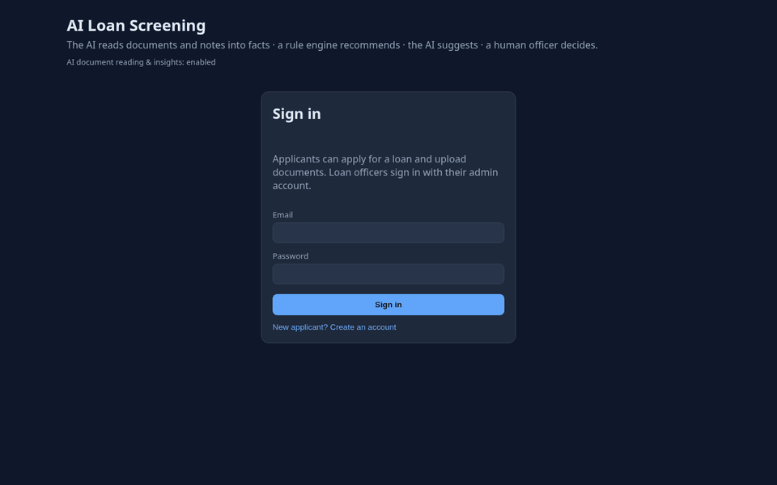
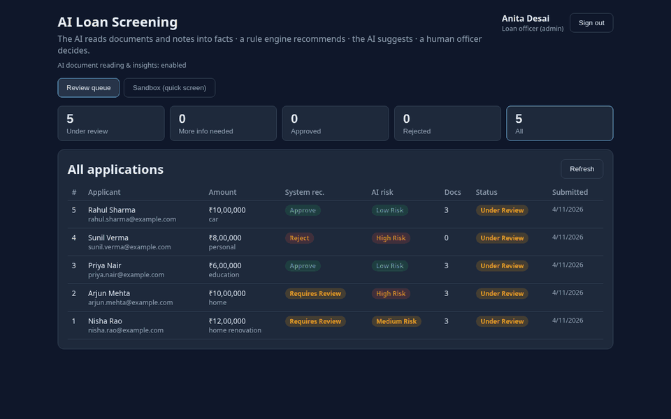
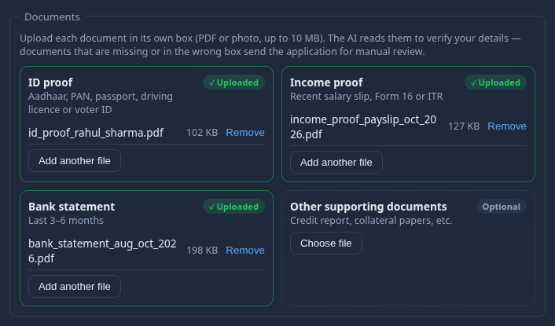
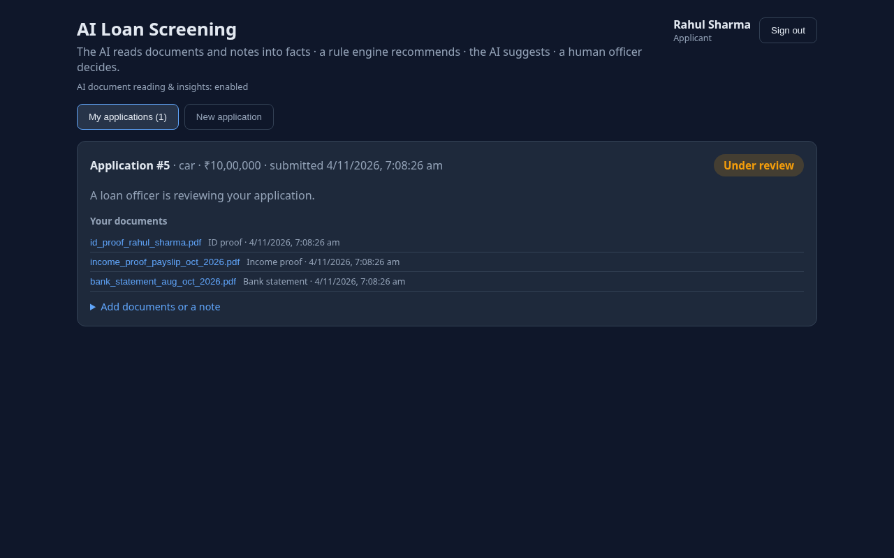
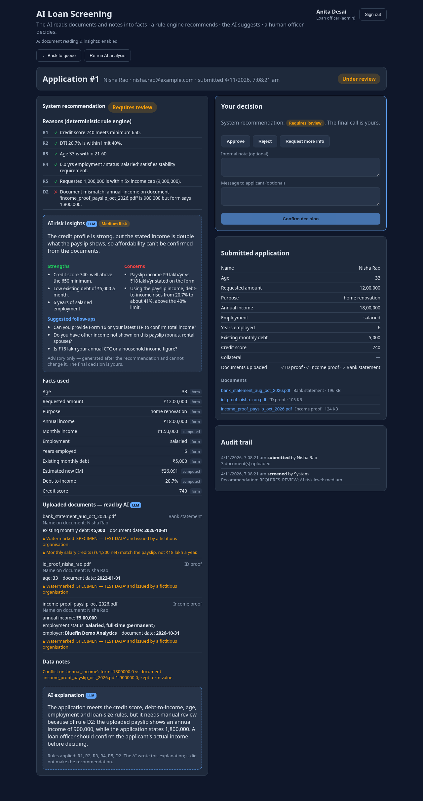
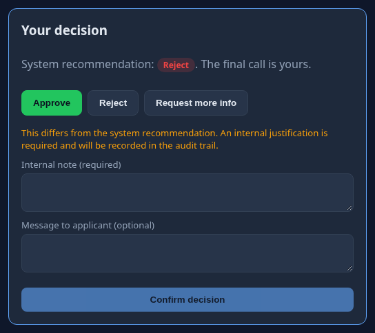
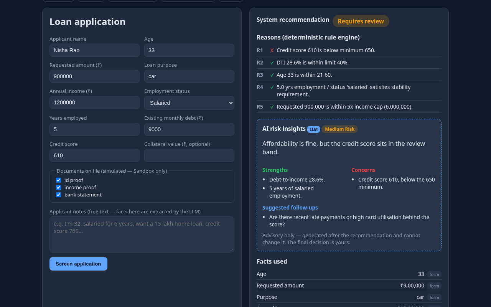

# Loan Screening — Frontend

React + TypeScript + Vite single-page app for the AI Loan Application Screening
Assistant. It has two panels:

- **Applicant panel:** register, apply for a loan, upload each document into
  its own box, track the status, read the loan officer's message, and add
  documents when asked.
- **Admin panel (loan officer):** review queue, the system recommendation with
  its reasons, AI document findings and risk insights, the **final decision**
  form, the document viewer, the audit trail, and a Sandbox.

| Applicant | Loan officer |
|---|---|
|  |  |

> The screenshots use fictional test documents. The AI text in them was written
> by Claude standing in for Gemini while the Gemini quota was exhausted;
> recommendations and calculations come from the backend's own code.

---

## Quick start

Requires Node 18+ and the [backend](../backend) running.

```bash
cp .env.example .env     # VITE_BACKEND_URL=http://127.0.0.1:8000
npm install
npm run dev              # http://localhost:5173
```

Sign in with the admin account from `backend/.env`, or create an applicant
account on the sign-in page. A private window is handy for using both roles at once.

| Script | Does |
|---|---|
| `npm run dev` | Dev server on :5173, sending `/api/*` to the backend |
| `npm run build` | Type-check (`tsc -b`) and build to `dist/` |
| `npm run preview` | Serve the production build locally |

---

## Configuration

| Variable | Purpose |
|---|---|
| `VITE_BACKEND_URL` | **Required.** Backend URL, no trailing slash. In dev, Vite proxies `/api` to it (no CORS needed). In a build, the app calls it directly, so the backend must allow your site's origin via `ALLOWED_ORIGINS`. |

`vite.config.ts` stops with a clear error if `VITE_BACKEND_URL` is missing.
Vite reads `.env` only at startup, so restart `npm run dev` after changing it.

---

## Screens

### Applicant: one upload box per document
ID proof, Income proof and Bank statement are required; Other is optional. Each
box shows *Required* or *✓ Uploaded* and accepts drag-and-drop. Files are checked
in the browser (type, 10 MB, at most 5 files), and the server checks them again.



Applicants see only their status and the officer's message, never the AI
analysis or the system recommendation.



### Admin: review queue
Counts per status, plus the system recommendation, AI risk level and document
count for each application. Click a row to review it.


### Admin: review and decide
The left column shows what the system produced: rule results, AI risk insights,
the facts used (each tagged *form*, *document · AI*, *notes · AI* or *computed*),
what the AI read from each document, data notes and the AI explanation. The
right column holds the decision form, the submitted data, the documents and the
audit trail.

<details>
<summary>Full review page</summary>


</details>

Going against the recommendation requires an internal justification. The UI
warns you, and the server enforces it.



### Admin: Sandbox
Stateless screening with example data (including "extract facts from notes").
Nothing is saved, and it's the only place the old "documents on file" tick boxes remain.



---

## Project layout

```
frontend/
├── index.html
├── vite.config.ts               dev server :5173, /api proxy → VITE_BACKEND_URL
├── .env.example
└── src/
    ├── main.tsx                 entry
    ├── App.tsx                  session check → AuthPage | ApplicantPanel | AdminPanel
    ├── api.ts                   typed API client, bearer token (localStorage), 401 handling
    ├── types.ts                 TypeScript copy of the backend contracts
    ├── examples.ts              Sandbox example applications
    ├── styles.css               dark theme, layout, badges, upload boxes
    └── components/
        ├── AuthPage.tsx         sign in / create applicant account
        ├── ApplicantPanel.tsx   my applications, new application, add documents
        ├── ApplicationForm.tsx  loan form (upload boxes, or simulated ticks in Sandbox)
        ├── DocumentSlots.tsx    one upload box per document type
        ├── AdminPanel.tsx       stats, queue, tabs
        ├── AdminReview.tsx      review page, decision form, documents, audit trail
        ├── DecisionResult.tsx   rules, AI insights, facts with sources, document findings
        ├── Badges.tsx           recommendation / status / risk badges
        └── Sandbox.tsx          stateless screening
```

### How it talks to the backend
- `api.ts` wraps `fetch`, adds `Authorization: Bearer <token>`, and turns
  FastAPI error details into readable messages. A 401 clears the session and
  returns you to sign-in.
- Uploads are sent as `multipart/form-data`: `application` (JSON), and each file
  as `files` with a matching `document_types` entry naming its box.
- Documents are opened through an authenticated `fetch` and a temporary blob
  URL, so the token never appears in a link.
- `types.ts` mirrors `backend/app/schemas.py` and `api_schemas.py`. Update both
  sides together.
